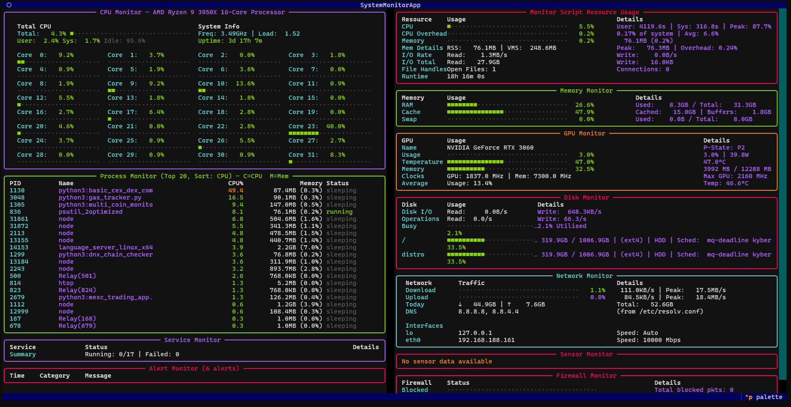

# System Monitor App

A quick host check should not require opening several monitoring utilities. System Monitor App brings resource use, processes and service information into a terminal workspace, making it useful for both local administration and remote command-line sessions.

## Tech stack

| Layer | Technologies |
|---|---|
| Application | Python |
| Supporting technologies | Textual; psutil; Linux |

## Read the machine at a glance

The screen is built from panels: CPU (with per-core load), Memory and swap, Network, Disk, GPU, Sensors (temperatures where the hardware reports them) and the monitor's own usage. Panels for hardware or drivers that are not present degrade instead of failing, so the same program runs on a plain server and on a workstation with a GPU.

The terminal overview provides a useful first check during a remote session. Compare the resource readings before deciding which process or surrounding service deserves attention.

## Find the process behind the load

The Process panel lists running processes and sorts them by CPU or by memory with one key, so the biggest consumer is at the top.

A process view connects resource use with a running workload. It helps move from noticing pressure to examining the application that may explain it.

## Check surrounding services

The Services panel shows the state of a list of important systemd services, and the Firewall panel shows the number of connections blocked by iptables or nftables. What each panel can show depends on the host and on the permissions the monitor runs with.

Process information alone may not explain the state of a machine. Nearby service views provide another perspective when the problem belongs to a managed workload rather than one process.

## Keep attention on changes

The Alerts panel keeps a history of the last 100 alerts raised by conditions you choose to watch. Preferences are stored in a configuration file in the user's home folder, and the program writes its own log there.

Changes are easier to follow when the important readings remain visible together. Keep the terminal open for the period relevant to the investigation instead of reconstructing a series of disconnected snapshots.

## Use a consistent remote workspace

It is a single program built with Textual and psutil, distributed as one self-contained Linux executable, so it runs in an ordinary SSH session without a graphical desktop on the monitored machine.

A familiar terminal workspace is useful across repeated administration sessions. It keeps common inspection tasks available without requiring a graphical desktop on the monitored machine.

---

Private code: [system-monitor-app](https://github.com/logicencoder/system-monitor-app)

See [REPOS.md](REPOS.md) for related repositories.

**[Logic Encoder](https://logicencoder.com)** · [GitHub](https://github.com/logicencoder) · [Contact](https://logicencoder.com/contact/)
